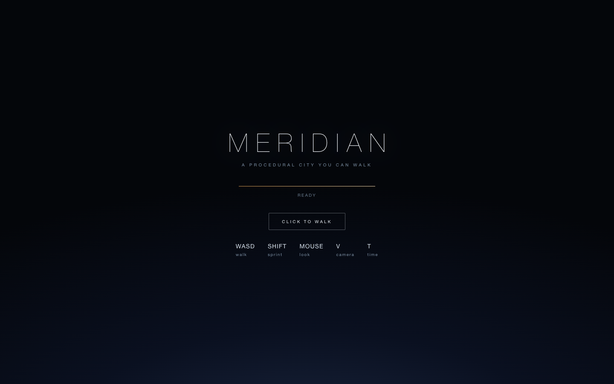
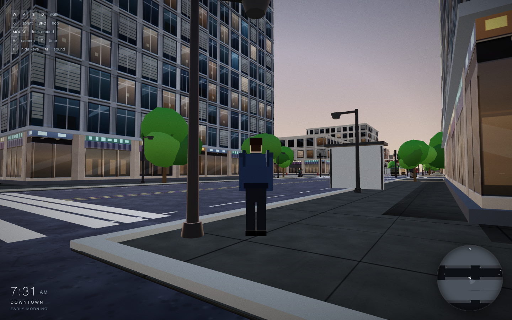
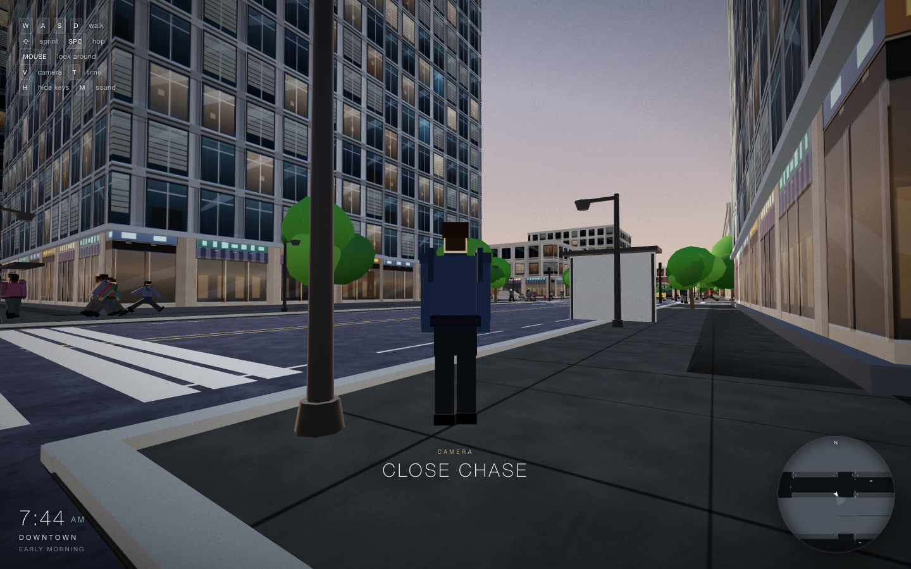
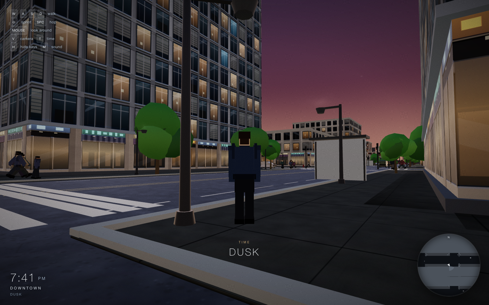
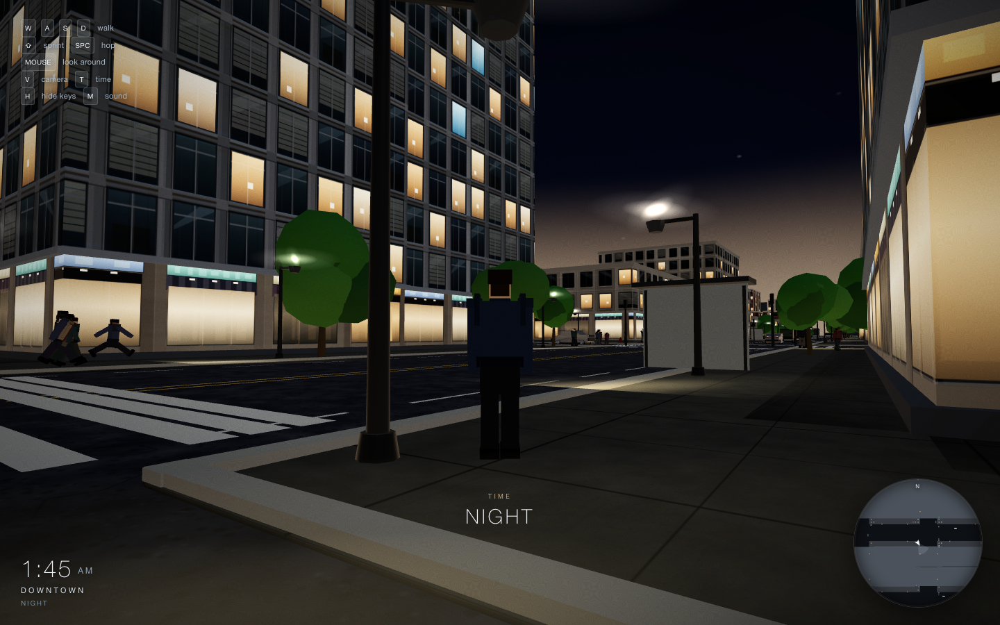
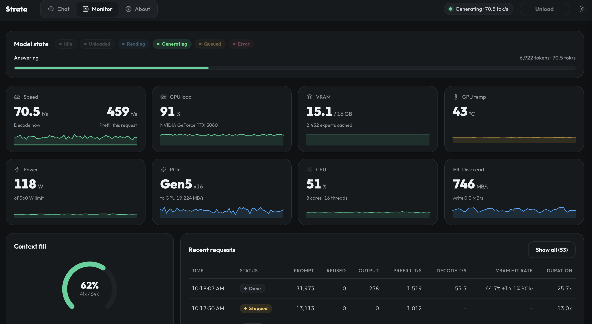

# MERIDIAN — a procedural city you can walk

A GTA-style third-person city in **one self-contained HTML file**. No assets, no
build step, no dependencies to install — just Three.js r128 pulled from cdnjs and
~193 KB of procedural code.

| | |
|---|---|
| Deliverable | [`src/city.html`](src/city.html) — 4,035 lines, 197,691 bytes, single file |
| Renderer | three.js **r128** from cdnjs (the only external file) |
| Assets | none — all textures, geometry, animation and audio are generated at runtime |
| Build | none — open the file in a browser |
| Tests | [`tests/`](tests/) — headless Chrome via CDP, Node built-ins only |

---

## Screenshots

All frames below are real captures from the artifact, taken headless at 1440×900
by the CDP harness in [`tests/`](tests/).

**Boot ladder** — the world is built in stages behind the title screen; the bar
advances per stage, then unlocks on click (the click is what grants pointer lock).



**Morning, downtown** — spawn block at 07:44. Glass curtain-wall and brick
facades, storefront strips, glowing street furniture, pedestrians on the far
sidewalk, live clock / district / time-of-day HUD and minimap.



**Camera mode `V`** — the second of three rigs (`wide follow` → `close chase` →
`first person`), confirmed by the toast in the frame.



**Dusk (19:41)** and **night (01:45)** — two `T` presses apart in the same
`cdp_night.js` scrub. The clock and time-of-day label in each caption are read off
that frame's own HUD. Window emissives, lamp pools and the sky ramp all come from
one colour ramp; the lighting dump at the end of that scrub has the sun at its floor
intensity (`i: 0.07`) and a near-black hemisphere tint (`#03060f`).




---

## How this was made

Everything in this repository — the 4,035-line artifact and the entire test
harness — was generated by an AI agent, end to end.

- **Agent harness:** [strata](https://github.com/niko1221/strata)
  (https://github.com/niko1221/strata)
- **Model:** `qwen3.8-flash-next-unsloth-ud-iq4_xs-v31`
  — Unsloth UD-IQ4_XS Dynamic v3.1 (2026-11-04)

### Runtime / hardware context

```
Context      : 65,536 tokens · KV cache: int8 · Experts: 46 GiB in RAM, cache auto
Hardware     : AMD Ryzen 7 9800X3D, 64GB DDR5, 2TB NVME,
               NVIDIA GeForce RTX 5080, 16303 MiB (VRAM reserve 1092 MiB)
Speculation  : 4 draft tokens (min p 0.5), MTP
Vision       : on
```

Worth noting what that context budget implies: the whole file was authored inside
a **single 65,536-token window**, so later fixes had to be made against the model's
own recollection of code it could not re-read in full. That constraint is the main
reason this repo has a test harness (below) rather than relying on eyeballing.

### Example performance

Captured from strata's Monitor tab while this repository was being generated (the
screenshot is the project author's own, not one of the harness frames above). Every
number below is read straight off the capture:



| | |
|---|---|
| Decode, live | 70.5 t/s |
| Prefill, request in flight | 459 t/s |
| Last finished request | 31,973-token prompt → 258 out · 1,519 t/s prefill · 55.5 t/s decode · 25.7 s |
| GPU load / temp | 91 % · 43 °C on the RTX 5080 |
| VRAM | 15.1 / 16 GB, 2,432 experts cached |
| VRAM hit rate | 64.7 % (+14.1 % from PCIe) |
| Context fill | 41k / 64K (62 %) |
| CPU | 51 % across 8 cores · 16 threads |
| Power | 118 W of a 360 W limit |
| PCIe | Gen5 x16, 19,224 MB/s to GPU |

Two things in this frame line up with the config block above it. The context ring
sits at **41k of 64K tokens** — the same 65,536-token window the whole artifact was
written inside. And the expert cache (**2,432 experts resident**, ~65 % VRAM hit
rate, the balance streamed in over PCIe) is what lets a 46 GiB expert set live on a
16 GB card: a 31,973-token prompt still prefills in ~21 s, while decode settles
around 55–70 t/s.

### The prompt

The prompt was read in from a **screenshot** of the prompt published at
[unsloth.ai/docs/models/qwen3.8-next](https://unsloth.ai/docs/models/qwen3.8-next)
(the model's own docs page), transcribed by vision, and passed to strata verbatim:

> Build a GTA-style city I can walk around and explore one self-contained HTML
> file, Three.js r128 from cdnjs, everything procedural, no assets. A city grid
> with roads, sidewalks, buildings, trees, cars and pedestrians walking around.
> Third-person character: WASD to walk, mouse to look, shift to sprint. Day/night
> cycle. Make it look good no placeholder cubes, no default UI. Write the whole
> thing in one pass. No clarifying questions

Every constraint in that prompt was honoured: one file, r128 from cdnjs, everything
procedural, no placeholder cubes, no default UI, and one pass with no clarifying
questions.

---

## Controls

| Key | Action |
|---|---|
| `W A S D` | walk |
| `Shift` | sprint |
| `Space` | hop |
| `Mouse` | look around (pointer lock) |
| `V` | cycle camera: wide follow → close chase → first person |
| `T` | jump time-of-day forward 3 h |
| `H` | show / hide the on-screen key legend |
| `M` | sound on / off |
| Click | enter the city from the title screen (grabs pointer lock) |

Pointer lock is entered on click; `Esc` releases it and the game pauses input.
Tab and arrow keys are `preventDefault`ed so the page never steals focus from
the walk.

---

## What's in the world

- **City plan** — an 11×11 block grid (`GRID = 11, BLOCK = 52, ROADW = 17,
  SW = 5.6`): 52 m blocks, 17 m roads, 5.6 m sidewalks, 69 m pitch. Named
  districts, plus park blocks carved out of the grid.
- **Buildings** — procedural facades with per-window geometry and emissives that
  light up at night; storefront strips at street level. No cubes.
- **Streets** — lanes, crosswalks, stop bars, curbs, street lamps, trees, bus
  shelters and other furniture.
- **Traffic** — cars are driven on a generated lane graph with traffic signals and
  AI that yields, queues and turns; headlights at night.
- **Pedestrians** — each body is **seven instanced parts posed per frame**, so the
  gait is actually animated rather than a sliding texture.
- **Player** — a rigged third-person character with a walking/sprinting gait,
  collision against a hashed collider list, and three camera rigs.
- **Day/night cycle** — the entire city (sky, fog, sun, ambient, exposure, window
  and lamp emissives) is driven from one colour ramp keyed to the city clock.
- **Audio** — one WebAudio graph, zero samples: continuous city beds plus one-shot
  event sounds.
- **HUD** — clock with AM/PM, district name, time-of-day label, toast messages,
  and a live minimap with a north ring.

### File map of `src/city.html`

One IIFE, 18 numbered sections:

```
  138  0. small utilities
  203  1. geometry: cached primitives + a merge builder that bakes transforms
  438  2. global state
  463  3. procedural textures (canvas) — seamless where it tiles
  985  4. city plan
 1179  5. materials + builders registry
 1278  6. buildings
 1522  7. streets, parks, furniture
 1868  8. collision + ground height
 1943  9. lane graph + traffic signals
 2022 10. traffic - procedural cars driven on the lane graph
 2287 11. traffic AI
 2525 12. pedestrians — a body is 7 instanced parts, so a gait can be posed
 2865 13. player — rig, gait, collision, camera
 3084 14. sky + day/night — the whole city is lit from one colour ramp
 3306 15. HUD — clock, district, toast, minimap
 3422 16. audio — one graph, zero samples. Beds for the city, one-shots for events.
 3770 17. renderer, boot ladder, input, main loop — the only section that touches
       GPU state or DOM events.
```

---

## Running it

```sh
open src/city.html          # macOS
```

Or serve it — `python3 -m http.server -d src 8000` — and open
`http://localhost:8000/city.html`. Requires network access for the cdnjs
three.js r128 script tag. Click the window to take pointer lock.

## Testing

```sh
sh tests/run.sh
```

Runs `syntax_check.js`, `check_strafe.js` and `cdp_smoke.js` — the smoke test
boots the real artifact in headless Chrome over CDP and shoots frames into
`tests/out/` (generated, safe to delete). Uses only Node built-ins; no npm
install. `tests/README.md` documents the individual probes (`cdp_scene`,
`cdp_diag`, `cdp_night`, `cdp_walk`, `cdp_probe`) and the `$CHROME` override.

The screenshots above came from `tests/cdp_probe.js` (daytime frames) and
`tests/cdp_night.js` (dusk and night frames, via the `T` key).

---

## Known limitations

Things that are real, so you don't chase them:

- **Headless pointer lock.** `--headless=new` never grants pointer lock to
  CDP-synthesised input, so `locked && started` stays false and scripted walks
  report `0 m`. That is a harness artifact, **not** a game bug — the day/night
  frames above are shot from the spawn pose for the same reason.
- **SwiftShader slow motion.** Software GL runs the sim at ~0.25× real time
  (`dt` clamps to 0.05 at ~5 fps), so scripted time-of-day jumps look slow.
- **Not yet verified in a real browser:** pointer-lock *feel*, sprint/hop
  behaviour, and first-person camera mode (`V` twice). The first-person frame is
  the one screenshot deliberately absent above — the captured frame shows the
  `WIDE FOLLOW` toast, not a first-person view.
- **Cosmetic:** the stop bar sits on the zebra band, so cars stop nose-in on the
  crosswalk.
- **Not a git repo.** This directory has no VCS history; `src/city.html` is the
  working copy and `tests/out/` is disposable output.

## Project docs

[`docs/agent/PROJECT_STATE.md`](docs/agent/PROJECT_STATE.md) keeps the running
checkpoint — decisions, verified fixes, open items — per
[`QWEN.md`](QWEN.md).

## Links

- Harness: https://github.com/niko1221/strata
- Model docs / prompt source: https://unsloth.ai/docs/models/qwen3.8-next
- Renderer: https://cdnjs.cloudflare.com/ajax/libs/three.js/r128/three.min.js
